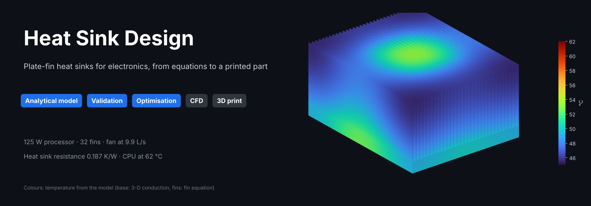
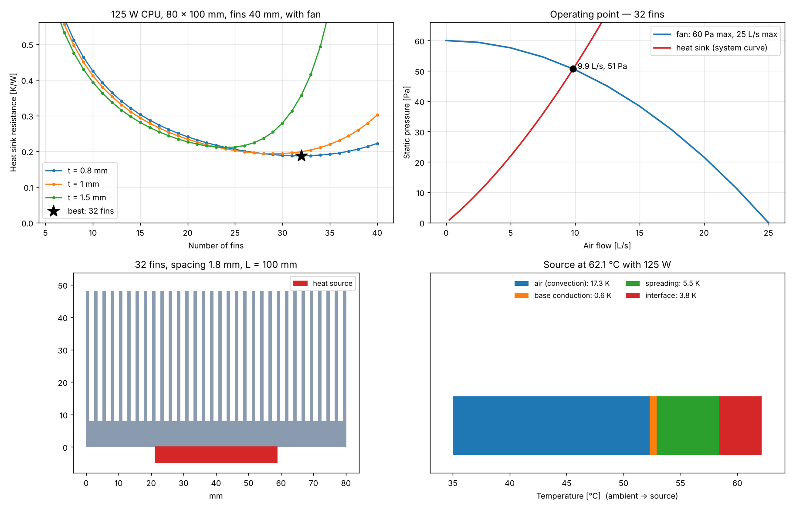
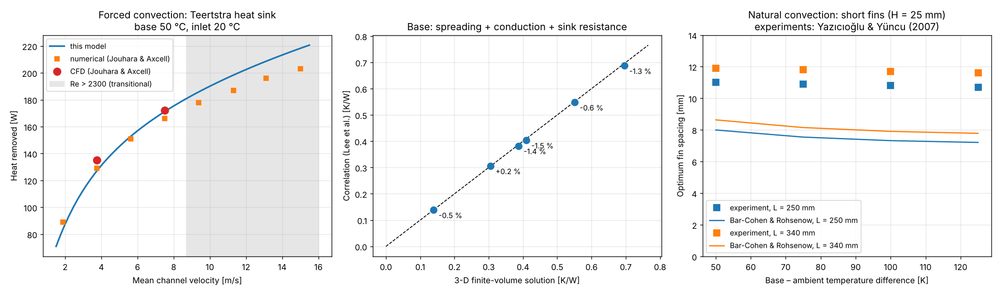
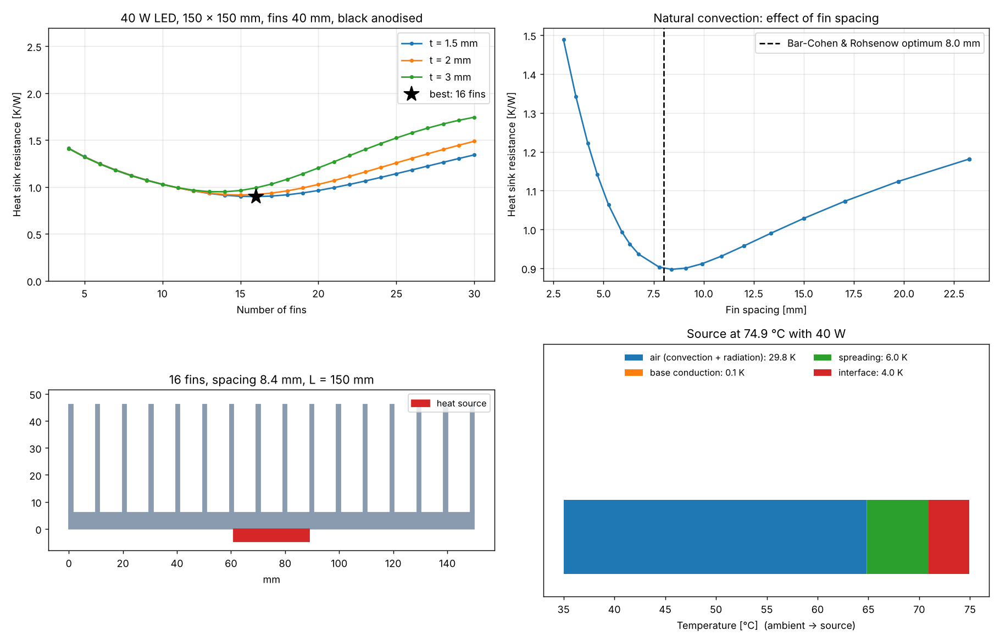
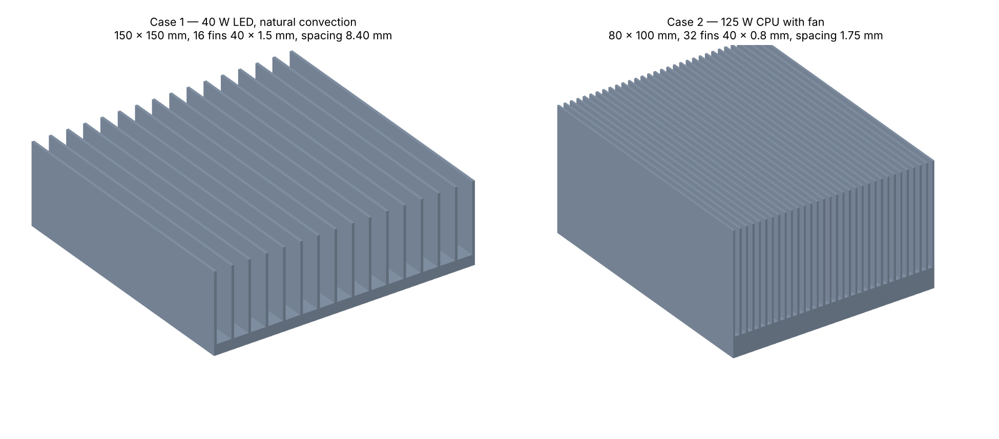

[](https://github.com/Raffoo26/heat-sink-design/actions/workflows/tests.yml)


🇬🇧 [English version](README.md)

Progetto di **dissipatori ad alette piane** per l'elettronica con un **modello termico analitico** in Python, **validato su dati CFD e sperimentali pubblicati e su una soluzione numerica 3-D della conduzione**, e poi **verificato con mie simulazioni CFD** (scambio termico coniugato in SimScale).

Due casi studio coprono entrambi i modi di raffreddamento:

| | Caso 1 — dissipatore passivo per LED | Caso 2 — dissipatore per processore con ventola |
|---|---|---|
| Raffreddamento | Convezione naturale + irraggiamento | Convezione forzata (ventola intubata) |
| Carico | LED COB da 40 W, ambiente a 35 °C | CPU da 125 W, aria a 35 °C nel case |
| Requisito | Case del LED ≤ 80 °C | Case della CPU ≤ 70 °C |
| Progetto ottimizzato | 150 × 150 mm, 16 alette 40 × 1.5 mm, passo libero 8.4 mm | 80 × 100 mm, 32 alette 40 × 0.8 mm, passo libero 1.75 mm |
| Risultato | **74.9 °C** (R = 0.90 K/W) | **62.1 °C** (R = 0.19 K/W) |



## Cosa fa il modello

Il dissipatore è una rete di resistenze termiche dalla sorgente di calore all'aria:

```
sorgente ─ R_interfaccia ─ R_diffusione ─ R_base ─┬─ R_convezione ─ aria
                                                  └─ R_irraggiamento ── ambiente
```

| Parte | Modello |
|---|---|
| Alette | Alette rettangolari diritte, rendimento η = tanh(mH)/(mH) con lunghezza corretta per l'estremità; rendimento globale della superficie |
| Convezione naturale | Canali verticali: **Bar-Cohen & Rohsenow** (1984); facce esterne: Churchill & Chu (1975); spaziatura ottima delle alette |
| Irraggiamento | Involucro grigio del dissipatore (anodizzato nero ≈ 0.85, alluminio grezzo ≈ 0.05) |
| Convezione forzata | Canali intubati, flusso laminare in sviluppo simultaneo: **Teertstra, Yovanovich & Culham** (1999) |
| Perdite di carico | Perdite di ingresso e uscita (Kays & London) + attrito apparente in flusso in sviluppo (Muzychka & Yovanovich; Shah & London) |
| Ventola | Qualsiasi curva caratteristica; il **punto di lavoro** è dove la pressione della ventola eguaglia la perdita di carico del dissipatore |
| Resistenza di diffusione | Sorgente più piccola della base: **Lee, Song, Au & Moran** (1995) |
| Aria | Proprietà reali da [CoolProp](http://www.coolprop.org/), valutate alla temperatura di film (iterata) |
| Ottimizzazione | Scansione del numero e dello spessore delle alette; minima resistenza del dissipatore |

## Validazione

Ogni verifica è un test automatico (`pytest`).



**1. Convezione forzata**: dissipatore provato da Teertstra et al. (L = 115 mm, 15 alette, H = 49 mm, t = 1.25 mm, passo libero 2.18 mm; base a 50 °C, aria in ingresso a 20 °C), simulato da Jouhara & Axcell (2009):

| Velocità nei canali | CFD pubblicata | Calcolo numerico pubblicato | Questo modello | Scarto |
|---|---|---|---|---|
| 1.88 m/s | – | 89 W | 83.9 W | −5.8 % |
| 3.75 m/s | 135 W | 129 W | 127.0 W | −5.9 % rispetto alla CFD |
| 5.63 m/s | – | 151 W | 152.8 W | +1.2 % |
| 7.51 m/s | 172 W | 166 W | 171.3 W | −0.4 % rispetto alla CFD |

Oltre circa 8 m/s il numero di Reynolds nei canali supera 2300: il flusso diventa di transizione e il modello laminare esce dal suo campo di validità (il programma lo segnala).

**2. Resistenza di diffusione**: la correlazione è confrontata con una mia **soluzione ai volumi finiti 3-D** della piastra di base (`heatsink/conduction.py`), su sei casi con dimensioni e spessore della piastra, dimensione della sorgente, conducibilità e raffreddamento diversi. La resistenza totale coincide **entro l'1.5 %**.

**3. Convezione naturale**: la spaziatura ottima del modello di Bar-Cohen & Rohsenow è confrontata con gli esperimenti di Yazıcıoğlu & Yüncu (2007). Gli andamenti sono corretti (spaziatura maggiore per alette più lunghe, minore per differenze di temperatura più alte), ma il modello prevede **7–9 mm dove gli esperimenti trovano 11–12 mm**. Quelle alette sono basse (H = 25 mm, circa 2 spaziature): l'aria entra nei canali anche dal lato aperto, un effetto tridimensionale che il modello a lastre piane parallele trascura. Il progetto del LED usa alette più alte (H/s ≈ 5), più vicine alle ipotesi del modello, ed è proprio ciò che la CFD deve verificare.

## Caso studio 1 — dissipatore passivo per un LED da 40 W

LED COB 28 × 28 mm con pasta termica (0.1 K/W), ambiente a 35 °C, dissipatore montato in verticale, alluminio 6063 anodizzato nero. Requisito: R_totale ≤ (80 − 35) / 40 = 1.125 K/W.

- Il progetto migliore ha **16 alette spesse 1.5 mm, passo libero 8.4 mm**, vicino all'ottimo di Bar-Cohen & Rohsenow (8.0 mm): con alette più fitte i canali si strozzano, con meno alette manca superficie.
- **L'irraggiamento porta via il 24 %** del calore. Lo stesso dissipatore in alluminio grezzo (ε = 0.05) porterebbe il LED a 81.2 °C, oltre il limite: l'anodizzazione non è solo estetica.
- Qui conviene usare alette sottili (rendimento 98 %): il flusso termico è basso e all'aria serve spazio, non metallo.



## Caso studio 2 — processore da 125 W con ventola

Diffusore di calore da 37.5 mm, pasta termica (0.03 K/W), ventola intubata (massimo 60 Pa, massimo 25 L/s), 35 °C dentro il case. Requisito: R_totale ≤ (70 − 35) / 125 = 0.28 K/W. Passo libero tra le alette limitato a ≥ 1.5 mm (alette incollate o ricavate per scorticatura; polvere).

- Più alette significano più superficie ma anche più perdita di carico, quindi la ventola fornisce meno aria. Con 12 alette la ventola spinge 20.1 L/s ma R = 0.365 K/W; l'ottimo è **32 alette spesse 0.8 mm**: 9.9 L/s a 51 Pa, **R = 0.187 K/W**, CPU a **62.1 °C**.
- L'ottimo è piatto: tra 28 e 36 alette la resistenza resta entro il 4 % dal migliore, quindi la scelta finale può seguire il costo di produzione.
- Il bilancio delle temperature mostra dove intervenire: 17 K nell'aria, 5.5 K di diffusione nella base (una base in rame o una camera di vapore li ridurrebbe), 3.8 K nella pasta termica.

## Modelli stampabili in 3D

Qualsiasi progetto può essere esportato come solido STL chiuso (`heatsink.export.write_stl`), pronto per il programma di stampa, un CAD o un generatore di mesh per la CFD. I due dissipatori ottimizzati sono in [`cad/`](cad) (in millimetri) e vengono stampati in plastica come modelli fisici dei risultati (foto in arrivo).



Si stampano con la base sul piatto: le alette sono pareti verticali, quindi non servono supporti. Il dissipatore della CPU ha alette da 0.8 mm (due linee con un ugello da 0.4 mm): va stampato a grandezza reale o più grande, mai rimpicciolito. Le sorgenti di calore (`led_source.stl`, `cpu_source.stl`) si possono stampare in un altro colore e incollare sotto la base. Elenco dei pezzi, impostazioni di stampa e scheda per controllare le misure: [docs/3d_printing.md](docs/3d_printing.md) (in inglese).

Un dissipatore stampato in plastica è un **modello, non un dissipatore funzionante**. Il modello termico mostra perché (caso del LED, stessa geometria, cambia solo il materiale):

| Materiale | k [W/(m·K)] | Rendimento alette | Temperatura del LED con 40 W |
|---|---|---|---|
| Alluminio 6063 | 209 | 98 % | 75 °C |
| Filamento caricato "termoconduttivo" (ipotesi) | 5 | 60 % | 284 °C |
| PLA / PETG | 0.2 | 12 % | > 2000 °C (si scioglie molto prima) |

## Verifica CFD (in corso)

I due progetti ottimizzati vengono simulati in [SimScale](https://www.simscale.com/) (scambio termico coniugato: conduzione nel solido + flusso d'aria, laminare). I risultati CFD (temperature di base e sorgente, perdita di carico, temperatura dell'aria in uscita) saranno confrontati qui con il modello. La configurazione è descritta in [docs/cfd_simscale.md](docs/cfd_simscale.md).

## Come usarlo

```bash
git clone https://github.com/Raffoo26/heat-sink-design.git
cd heat-sink-design
pip install -r requirements.txt
python examples/led_natural_example.py
python examples/cpu_fan_example.py
python examples/validation_example.py
python examples/export_stl.py
pytest
```

```python
from heatsink import PlateFinHeatSink, HeatSource, Fan, analyze

hs = PlateFinHeatSink(W=0.08, L=0.10, H=0.04, t=0.8e-3, N=32, tb=0.008)   # metri
cpu = HeatSource(0.0375, 0.0375, R_contact=0.03)
fan = Fan.quadratic(p_max=60, flow_max=0.025)          # oppure Fan(portate, pressioni) da una scheda tecnica

r = analyze(hs, cpu, Q=125, T_amb_C=35, fan=fan)      # oppure velocity=3.0, oppure niente = convezione naturale
print(r.summary())
print(r.R_heatsink, r.T_source - 273.15, r.pressure_drop)
```

| Ingresso | Significato |
|---|---|
| `W`, `L`, `H`, `t`, `tb` | Larghezza della base (trasversale alle alette), lunghezza delle alette (lungo il flusso d'aria / verticale), altezza e spessore delle alette, spessore della base [m] |
| `N` | Numero di alette (`PlateFinHeatSink.from_spacing(...)` lo ricava da una spaziatura desiderata) |
| `k`, `emissivity` | Conducibilità [W/(m·K)] (`MATERIALS` contiene leghe di alluminio e rame), emissività della superficie |
| `HeatSource(a, b, R_contact)` | Impronta della sorgente [m], centrata sulla base, e resistenza di interfaccia [K/W] |
| `analyze(..., Q, T_amb_C, velocity=None, fan=None)` | Potenza [W] e ambiente [°C]; velocità di avvicinamento sull'area frontale alettata W·H [m/s] oppure una ventola |

Risultati: `R_heatsink` (base sotto la sorgente → ambiente, come nelle schede tecniche), `R_total`, le singole resistenze, `T_base`, `T_source` [K], `h`, `eta_fin`, `Q_rad`, `flow_rate`, `velocity`, `pressure_drop` [Pa], `Re`, `T_air_out`, `s_opt`, `warnings`. `heatsink.optimize.sweep_fins` e `best_design` eseguono gli studi di progetto; `heatsink.plots` li disegna.

## Struttura del progetto

```text
heatsink/          air.py (proprietà), geometry.py, correlations.py, model.py,
                   conduction.py (verifica 3-D), optimize.py, plots.py,
                   export.py (STL), render.py e thermal_map.py (immagini 3-D)
examples/          i due casi studio, i grafici di validazione e l'esportazione STL
cad/               modelli STL dei dissipatori ottimizzati e delle sorgenti di calore
tests/             validazione su dati pubblicati + test unitari
docs/              configurazione della CFD e guida alla stampa 3D
images/            figure di questo README
```

## Limiti

Regime stazionario; flusso laminare; alette a sezione costante su base piana; flusso forzato completamente intubato (niente aria che aggira le alette); convezione naturale solo con canali verticali; irraggiamento dall'involucro del dissipatore; flusso termico uniforme sulla sorgente; aria a pressione atmosferica. Le alette basse in convezione naturale sono fuori dal campo in cui il modello funziona meglio (vedi validazione 3).

## Bibliografia

- A. Bar-Cohen, W. M. Rohsenow, *Thermally optimum spacing of vertical, natural convection cooled, parallel plates*, J. Heat Transfer 106 (1984).
- P. Teertstra, M. M. Yovanovich, J. R. Culham, *Analytical forced convection modeling of plate fin heat sinks*, IEEE SEMI-THERM (1999).
- H. Jouhara, B. P. Axcell, *Modelling and simulation techniques for forced convection heat transfer in heat sinks with rectangular fins*, Simulation Modelling Practice and Theory 17 (2009).
- S. Lee, S. Song, V. Au, K. P. Moran, *Constriction/spreading resistance model for electronics packaging*, ASME/JSME Thermal Engineering Conference (1995).
- B. Yazıcıoğlu, H. Yüncu, *Optimum fin spacing of rectangular fins on a vertical base in free convection heat transfer*, Heat and Mass Transfer 44 (2007).
- Y. S. Muzychka, M. M. Yovanovich, *Modeling friction factors in non-circular ducts for developing laminar flow*, AIAA (1998); R. K. Shah, A. L. London, *Laminar Flow Forced Convection in Ducts* (1978); W. M. Kays, A. L. London, *Compact Heat Exchangers*.
- S. W. Churchill, H. H. S. Chu, *Correlating equations for laminar and turbulent free convection from a vertical plate*, Int. J. Heat Mass Transfer 18 (1975).

## Roadmap

- [x] Modello analitico, convezione naturale e forzata, punto di lavoro della ventola
- [x] Validazione su dati pubblicati e su una soluzione 3-D della conduzione
- [x] Due casi studio ottimizzati
- [x] Esportazione STL e modelli stampati in 3D
- [ ] Verifica CFD di entrambi i progetti (SimScale)
- [ ] Web app per progettare il proprio dissipatore
