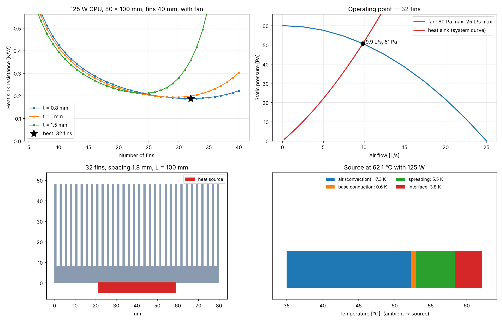
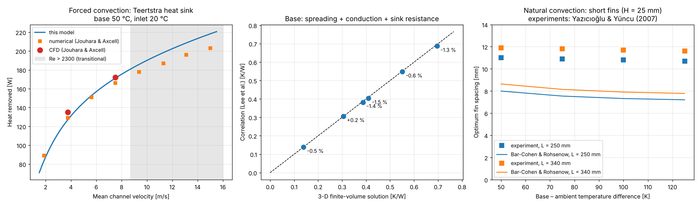
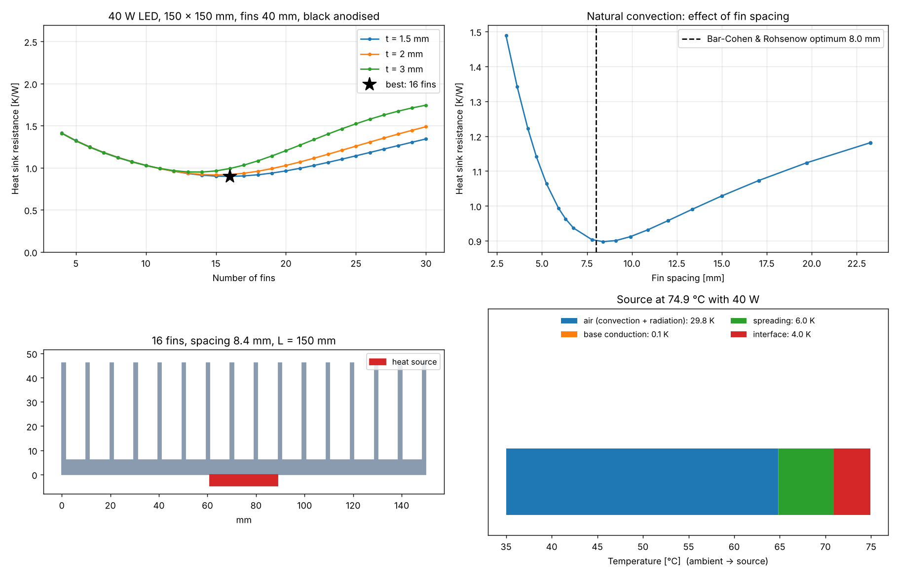

# Heat Sink Design

🇮🇹 [Versione italiana](README.it.md)

Design of **plate-fin heat sinks** for electronics with an **analytical thermal model** in Python, **validated against published CFD and experimental data and a 3-D numerical conduction solution**, and then **verified with my own CFD simulations** (conjugate heat transfer in SimScale).

Two case studies cover both cooling modes:

| | Case 1 — passive LED heat sink | Case 2 — processor heat sink with fan |
|---|---|---|
| Cooling | Natural convection + radiation | Forced convection (ducted fan) |
| Load | 40 W COB LED, 35 °C ambient | 125 W CPU, 35 °C air in the case |
| Requirement | LED case ≤ 80 °C | CPU case ≤ 70 °C |
| Optimised design | 150 × 150 mm, 16 fins 40 × 1.5 mm, spacing 8.4 mm | 80 × 100 mm, 32 fins 40 × 0.8 mm, spacing 1.75 mm |
| Result | **74.9 °C** (R = 0.90 K/W) | **62.1 °C** (R = 0.19 K/W) |



## What the model does

The heat sink is a thermal resistance network from the heat source to the air:

```
source ─ R_interface ─ R_spreading ─ R_base ─┬─ R_convection ─ air
                                             └─ R_radiation ── surroundings
```

| Part | Model |
|---|---|
| Fins | Straight rectangular fins, efficiency η = tanh(mH)/(mH) with corrected length for the tip; overall surface efficiency |
| Natural convection | Vertical channels: **Bar-Cohen & Rohsenow** (1984); outer faces: Churchill & Chu (1975); optimum fin spacing |
| Radiation | Grey envelope of the heat sink (black anodised ≈ 0.85, bare aluminium ≈ 0.05) |
| Forced convection | Ducted channels, simultaneously developing laminar flow: **Teertstra, Yovanovich & Culham** (1999) |
| Pressure drop | Entrance/exit losses (Kays & London) + apparent friction in developing flow (Muzychka & Yovanovich; Shah & London) |
| Fan | Any fan curve; the **operating point** is where the fan pressure equals the heat sink pressure drop |
| Spreading resistance | Heat source smaller than the base: **Lee, Song, Au & Moran** (1995) |
| Air | Real properties from [CoolProp](http://www.coolprop.org/), evaluated at the film temperature (iterated) |
| Optimisation | Sweep of number and thickness of fins; minimum heat sink resistance |

## Validation

Every check is an automated test (`pytest`).



**1. Forced convection** — heat sink tested by Teertstra et al. (L = 115 mm, 15 fins, H = 49 mm, t = 1.25 mm, spacing 2.18 mm; base at 50 °C, inlet air at 20 °C), simulated by Jouhara & Axcell (2009):

| Channel velocity | Published CFD | Published numerical | This model | Difference |
|---|---|---|---|---|
| 1.88 m/s | – | 89 W | 83.9 W | −5.8 % |
| 3.75 m/s | 135 W | 129 W | 127.0 W | −5.9 % vs CFD |
| 5.63 m/s | – | 151 W | 152.8 W | +1.2 % |
| 7.51 m/s | 172 W | 166 W | 171.3 W | −0.4 % vs CFD |

Above about 8 m/s the channel Reynolds number exceeds 2300: the flow becomes transitional and the laminar model is outside its range (the program warns).

**2. Spreading resistance** — the correlation is compared with my own **3-D finite-volume solution** of the base plate (`heatsink/conduction.py`): six cases with different plate size, thickness, source size, conductivity and cooling. The total resistance agrees **within 1.5 %**.

**3. Natural convection** — the optimum spacing of the Bar-Cohen & Rohsenow model is compared with the experiments of Yazıcıoğlu & Yüncu (2007). The trends are right (wider spacing for longer fins, narrower for higher temperature differences), but the model predicts **7–9 mm where the experiments find 11–12 mm**. Those fins are short (H = 25 mm, only about 2 spacings): air enters the channels also from the open front, a three-dimensional effect that the parallel-plate model ignores. The LED design uses taller fins (H/s ≈ 5), closer to the model's assumptions, and this is exactly what the CFD is meant to check.

## Case study 1 — passive heat sink for a 40 W LED

28 × 28 mm COB LED with thermal paste (0.1 K/W), 35 °C ambient, heat sink mounted vertically, black anodised aluminium 6063. The requirement R_total ≤ (80 − 35) / 40 = 1.125 K/W.

- The best design has **16 fins 1.5 mm thick, spacing 8.4 mm**, close to the Bar-Cohen & Rohsenow optimum (8.0 mm): with closer fins the channels choke, with fewer fins there is not enough surface.
- **Radiation carries 24 %** of the heat. The same heat sink in bare aluminium (ε = 0.05) would run the LED at 81.2 °C, over the limit: anodising is not cosmetic.
- Thinner fins are better here (efficiency 98 %): the heat flux is low and the air needs space, not metal.



## Case study 2 — 125 W processor with a fan

37.5 mm heat spreader, thermal paste (0.03 K/W), ducted fan (60 Pa maximum, 25 L/s maximum), 35 °C inside the case. Requirement R_total ≤ (70 − 35) / 125 = 0.28 K/W. Fin spacing limited to ≥ 1.5 mm (bonded or skived fins; dust).

- More fins mean more surface but also more pressure drop, so the fan delivers less air. With 12 fins the fan pushes 20.1 L/s but R = 0.365 K/W; the optimum is **32 fins 0.8 mm thick**: 9.9 L/s at 51 Pa, **R = 0.187 K/W**, CPU at **62.1 °C**.
- The optimum is flat: from 28 to 36 fins the resistance stays within 4 % of the best, so the final choice can follow manufacturing cost.
- The temperature budget shows where to act next: 17 K in the air, 5.5 K spreading in the base (a copper base or a vapour chamber would cut it), 3.8 K in the thermal paste.

## CFD verification (in progress)

The two optimised designs are simulated in [SimScale](https://www.simscale.com/) (conjugate heat transfer: solid conduction + air flow, laminar). The CFD results (base and source temperatures, pressure drop, outlet air temperature) will be compared with the model here. The set-up is described in [docs/cfd_simscale.md](docs/cfd_simscale.md).

## Use it

```bash
git clone https://github.com/Raffoo26/heat-sink-design.git
cd heat-sink-design
pip install -r requirements.txt
python examples/led_natural_example.py
python examples/cpu_fan_example.py
python examples/validation_example.py
pytest
```

```python
from heatsink import PlateFinHeatSink, HeatSource, Fan, analyze

hs = PlateFinHeatSink(W=0.08, L=0.10, H=0.04, t=0.8e-3, N=32, tb=0.008)   # metres
cpu = HeatSource(0.0375, 0.0375, R_contact=0.03)
fan = Fan.quadratic(p_max=60, flow_max=0.025)          # or Fan(flows, pressures) from a datasheet

r = analyze(hs, cpu, Q=125, T_amb_C=35, fan=fan)      # or velocity=3.0, or nothing = natural convection
print(r.summary())
print(r.R_heatsink, r.T_source - 273.15, r.pressure_drop)
```

| Input | Meaning |
|---|---|
| `W`, `L`, `H`, `t`, `tb` | Base width (across the fins), fin length (along the air flow / vertical), fin height, fin thickness, base thickness [m] |
| `N` | Number of fins (`PlateFinHeatSink.from_spacing(...)` builds it from a target spacing) |
| `k`, `emissivity` | Conductivity [W/(m·K)] (`MATERIALS` has aluminium alloys and copper), surface emissivity |
| `HeatSource(a, b, R_contact)` | Source footprint [m], centred on the base, and interface resistance [K/W] |
| `analyze(..., Q, T_amb_C, velocity=None, fan=None)` | Power [W] and ambient [°C]; approach velocity over the finned frontal area W·H [m/s] or a fan |

Results: `R_heatsink` (base under the source → ambient, as in datasheets), `R_total`, the single resistances, `T_base`, `T_source` [K], `h`, `eta_fin`, `Q_rad`, `flow_rate`, `velocity`, `pressure_drop` [Pa], `Re`, `T_air_out`, `s_opt`, `warnings`. `heatsink.optimize.sweep_fins` and `best_design` run design studies; `heatsink.plots` draws them.

## Project structure

```text
heatsink/          air.py (properties), geometry.py, correlations.py, model.py,
                   conduction.py (3-D check), optimize.py, plots.py
examples/          the two case studies and the validation plots
tests/             validation against published data + unit tests
docs/              CFD set-up
images/            figures in this README
```

## Limits

Steady state; laminar flow; fins with uniform cross-section on a flat base; fully ducted forced flow (no bypass around the fins); natural convection with vertical channels only; radiation from the envelope of the heat sink; uniform heat flux over the source; air at atmospheric pressure. Short fins in natural convection are outside the model's best range (see validation 3).

## References

- A. Bar-Cohen, W. M. Rohsenow, *Thermally optimum spacing of vertical, natural convection cooled, parallel plates*, J. Heat Transfer 106 (1984).
- P. Teertstra, M. M. Yovanovich, J. R. Culham, *Analytical forced convection modeling of plate fin heat sinks*, IEEE SEMI-THERM (1999).
- H. Jouhara, B. P. Axcell, *Modelling and simulation techniques for forced convection heat transfer in heat sinks with rectangular fins*, Simulation Modelling Practice and Theory 17 (2009).
- S. Lee, S. Song, V. Au, K. P. Moran, *Constriction/spreading resistance model for electronics packaging*, ASME/JSME Thermal Engineering Conference (1995).
- B. Yazıcıoğlu, H. Yüncu, *Optimum fin spacing of rectangular fins on a vertical base in free convection heat transfer*, Heat and Mass Transfer 44 (2007).
- Y. S. Muzychka, M. M. Yovanovich, *Modeling friction factors in non-circular ducts for developing laminar flow*, AIAA (1998); R. K. Shah, A. L. London, *Laminar Flow Forced Convection in Ducts* (1978); W. M. Kays, A. L. London, *Compact Heat Exchangers*.
- S. W. Churchill, H. H. S. Chu, *Correlating equations for laminar and turbulent free convection from a vertical plate*, Int. J. Heat Mass Transfer 18 (1975).

## Roadmap

- [x] Analytical model, natural and forced convection, fan operating point
- [x] Validation against published data and a 3-D conduction solution
- [x] Two optimised case studies
- [ ] CFD verification of both designs (SimScale)
- [ ] Web app to design your own heat sink
